# ambientCG: Wood materials

**27 assets from [ambientCG](https://ambientcg.com), dedicated to the public domain under [CC0](https://docs.ambientcg.com/license/).** Use them in any game, free or paid, and change them however you like; no credit is needed.

PBR materials as 1K and 2K JPG maps (colour, normal GL and DX, roughness, AO, displacement), one folder per resolution. 899.3 MB in all.

This is a copy kept by [zuujis-cc0](https://github.com/zuujis-cc0) so game makers can take single files from GitHub. It is not made by or affiliated with ambientCG: the originals, often in more formats and higher resolutions, are on [ambientcg.com](https://ambientcg.com). If they help you, consider [supporting ambientCG](https://www.patreon.com/ambientCG).

Every file is listed in [MANIFEST.tsv](MANIFEST.tsv) with its size and SHA-256. More free assets: [the Zuujis collection](https://github.com/zuujis-cc0/free-game-assets#readme).

| | | | |
| :-: | :-: | :-: | :-: |
| <a href="Wood062">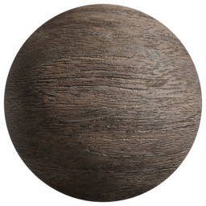</a> <b><a href="Wood062">Wood 062</a></b> by ambientCG · <a href="https://ambientcg.com/a/Wood062">source</a> | <a href="Wood063">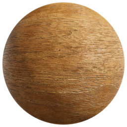</a> <b><a href="Wood063">Wood 063</a></b> by ambientCG · <a href="https://ambientcg.com/a/Wood063">source</a> | <a href="Wood064">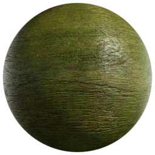</a> <b><a href="Wood064">Wood 064</a></b> by ambientCG · <a href="https://ambientcg.com/a/Wood064">source</a> | <a href="Wood065">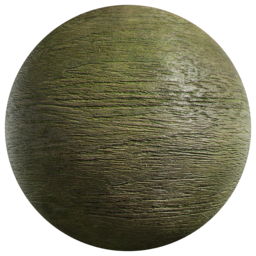</a> <b><a href="Wood065">Wood 065</a></b> by ambientCG · <a href="https://ambientcg.com/a/Wood065">source</a> |
| <a href="Wood066">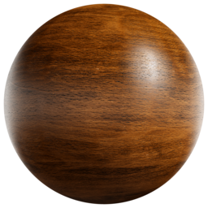</a> <b><a href="Wood066">Wood 066</a></b> by ambientCG · <a href="https://ambientcg.com/a/Wood066">source</a> | <a href="Wood067">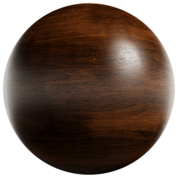</a> <b><a href="Wood067">Wood 067</a></b> by ambientCG · <a href="https://ambientcg.com/a/Wood067">source</a> | <a href="Wood068">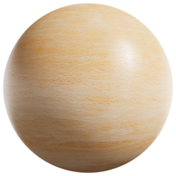</a> <b><a href="Wood068">Wood 068</a></b> by ambientCG · <a href="https://ambientcg.com/a/Wood068">source</a> | <a href="Wood069">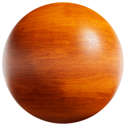</a> <b><a href="Wood069">Wood 069</a></b> by ambientCG · <a href="https://ambientcg.com/a/Wood069">source</a> |
| <a href="Wood070">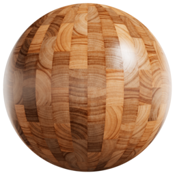</a> <b><a href="Wood070">Wood 070</a></b> by ambientCG · <a href="https://ambientcg.com/a/Wood070">source</a> | <a href="Wood071">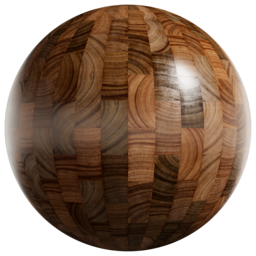</a> <b><a href="Wood071">Wood 071</a></b> by ambientCG · <a href="https://ambientcg.com/a/Wood071">source</a> | <a href="Wood072">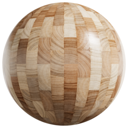</a> <b><a href="Wood072">Wood 072</a></b> by ambientCG · <a href="https://ambientcg.com/a/Wood072">source</a> | <a href="Wood073">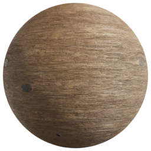</a> <b><a href="Wood073">Wood 073</a></b> by ambientCG · <a href="https://ambientcg.com/a/Wood073">source</a> |
| <a href="Wood074">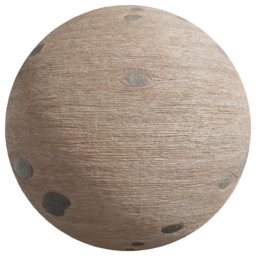</a> <b><a href="Wood074">Wood 074</a></b> by ambientCG · <a href="https://ambientcg.com/a/Wood074">source</a> | <a href="Wood075">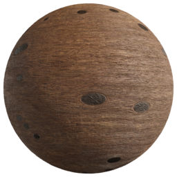</a> <b><a href="Wood075">Wood 075</a></b> by ambientCG · <a href="https://ambientcg.com/a/Wood075">source</a> | <a href="Wood076">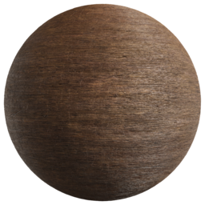</a> <b><a href="Wood076">Wood 076</a></b> by ambientCG · <a href="https://ambientcg.com/a/Wood076">source</a> | <a href="Wood077">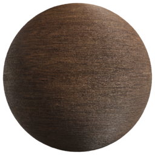</a> <b><a href="Wood077">Wood 077</a></b> by ambientCG · <a href="https://ambientcg.com/a/Wood077">source</a> |
| <a href="Wood078">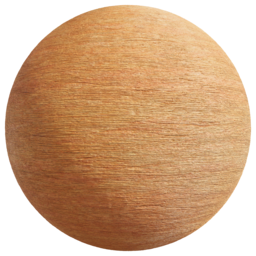</a> <b><a href="Wood078">Wood 078</a></b> by ambientCG · <a href="https://ambientcg.com/a/Wood078">source</a> | <a href="Wood079">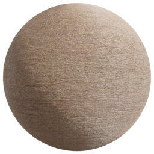</a> <b><a href="Wood079">Wood 079</a></b> by ambientCG · <a href="https://ambientcg.com/a/Wood079">source</a> | <a href="Wood080">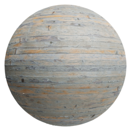</a> <b><a href="Wood080">Wood 080</a></b> by ambientCG · <a href="https://ambientcg.com/a/Wood080">source</a> | <a href="Wood081">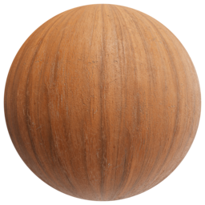</a> <b><a href="Wood081">Wood 081</a></b> by ambientCG · <a href="https://ambientcg.com/a/Wood081">source</a> |
| <a href="Wood082A">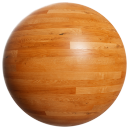</a> <b><a href="Wood082A">Wood 082 A</a></b> by ambientCG · <a href="https://ambientcg.com/a/Wood082A">source</a> | <a href="Wood082B">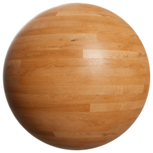</a> <b><a href="Wood082B">Wood 082 B</a></b> by ambientCG · <a href="https://ambientcg.com/a/Wood082B">source</a> | <a href="Wood083A">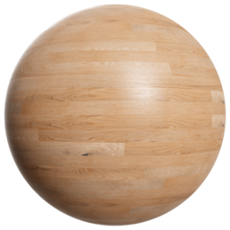</a> <b><a href="Wood083A">Wood 083 A</a></b> by ambientCG · <a href="https://ambientcg.com/a/Wood083A">source</a> | <a href="Wood083B">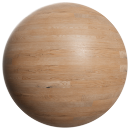</a> <b><a href="Wood083B">Wood 083 B</a></b> by ambientCG · <a href="https://ambientcg.com/a/Wood083B">source</a> |
| <a href="Wood084A">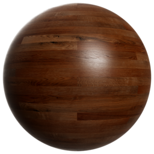</a> <b><a href="Wood084A">Wood 084 A</a></b> by ambientCG · <a href="https://ambientcg.com/a/Wood084A">source</a> | <a href="Wood084B">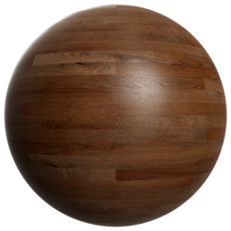</a> <b><a href="Wood084B">Wood 084 B</a></b> by ambientCG · <a href="https://ambientcg.com/a/Wood084B">source</a> | <a href="Wood085A">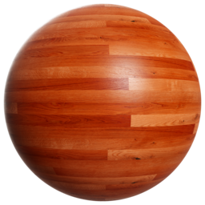</a> <b><a href="Wood085A">Wood 085 A</a></b> by ambientCG · <a href="https://ambientcg.com/a/Wood085A">source</a> |  |

---

Kept up to date by this repository's own [update workflow](.github/workflows/update.yml), with code and plan from [cc0-mirror](https://github.com/zuujis-cc0/cc0-mirror). Something wrong? [Open an issue there](https://github.com/zuujis-cc0/cc0-mirror/issues/new) or use the [private report form](https://games.zuujis.com/report).
